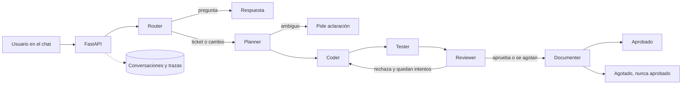
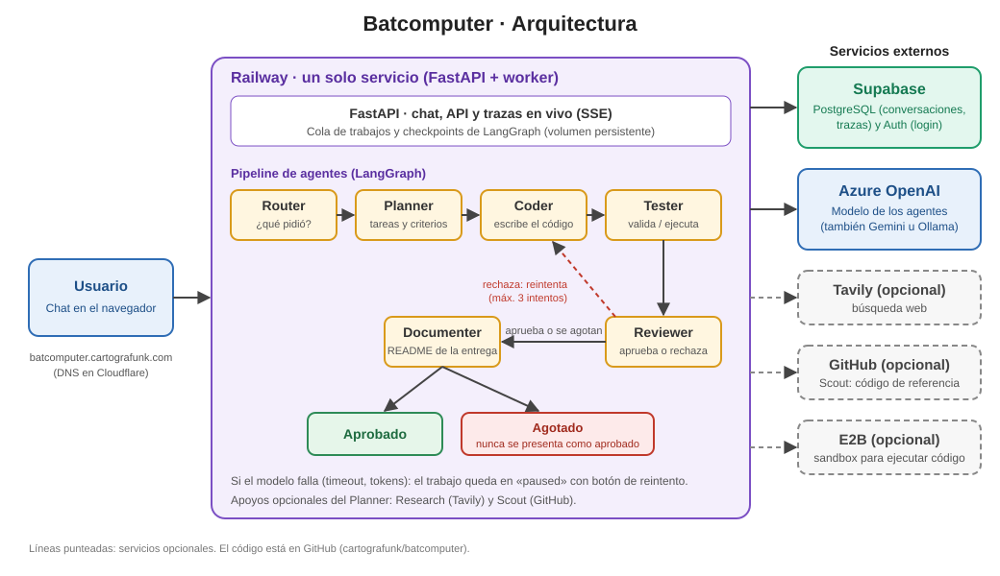

# Batcomputer

Batcomputer es un aplicativo de un sistema multiagente de inteligencia artificial. El sistema recibe un ticket de desarrollo en lenguaje natural y un equipo de agentes de IA lo planea, lo programa, lo prueba y lo revisa hasta entregar código funcional revisado en su sintaxis. Además el sistema permite la **trazabilidad** al habilitar el mismo hilo para pedir cambios o hacer preguntas, y reportar qué decidió cada agente en un panel de trazas aparte.

**Sistema en línea:** <https://batcomputer.cartografunk.com/> (puedes entrar con **Entrar como invitado**).
**Resumen de la prueba (qué haría distinto y qué pasa cuando Reviewer y Coder no coinciden):** [docs/Resumen.docx](docs/Resumen.docx)

## Cómo funciona (versión corta)

Piensa en una pequeña agencia de desarrollo:

| Agente | Rol | Qué hace |
|---|---|---|
| Router | Recepción | Decide si tu mensaje es un ticket nuevo, un cambio a lo anterior o una pregunta. |
| Planner | Líder técnico | Convierte el ticket en tareas y criterios de aceptación. Si algo es ambiguo, pide una aclaración. |
| Coder | Programador | Implementa el plan y entrega los archivos completos. |
| Tester | QA | Revisa sintaxis de Python y JSON (y ejecuta pruebas en un sandbox si hay E2B configurado). |
| Reviewer | Project manager | Compara la entrega con el plan. Aprueba o rechaza con feedback. |
| Documenter | Redactor | Deja un README de la entrega y el resultado de la validación. |

Apoyos opcionales que el Planner activa solo cuando hacen falta: **Research** (búsqueda web con Tavily) y **Scout** (referencias de código en GitHub con licencias permisivas).

**El ciclo de revisión:** si el Reviewer rechaza, el Coder recibe el feedback y reintenta. El máximo es `MAX_CODER_ATTEMPTS` (3 por defecto: primer intento + 2 correcciones). Si se agota, la entrega queda en estado `exhausted` y **nunca se presenta como aprobada**.

**Cuando algo falla** (timeout, respuesta malformada, tokens agotados) el sistema explica qué pasó y deja la ejecución en `paused` con un botón de reintento.

**Trazas:** los pasos de cada agente se emiten en vivo por SSE y se consultan aparte del chat. El chat solo muestra la respuesta final de cada turno.




## Correrlo localmente

Requiere Python 3.11 o superior.

macOS o Linux:

```sh
git clone https://github.com/cartografunk/batcomputer.git
cd batcomputer
python3 -m venv .venv
. .venv/bin/activate
python -m pip install -e '.[test]'
cp .env.example .env
# Edita AUTH_TOKENS y, para usar un modelo real, MODEL_API_KEY en .env
python -m uvicorn app.main:app --reload
```

Windows (PowerShell):

```powershell
python -m venv .venv
.\.venv\Scripts\python.exe -m pip install -e ".[test]"
Copy-Item .env.example .env
.\.venv\Scripts\python.exe -m uvicorn app.main:app --reload
```

Abre <http://localhost:8000> y envía un ticket. Localmente usa SQLite y `AUTH_MODE=legacy` (cookie anónima, solo para desarrollo).

## Variables de entorno

Nunca se versionan claves: el repositorio solo incluye `.env.example` sin valores.

| Variable | Para qué sirve |
|---|---|
| `MODEL_API_KEY` | Clave del proveedor del modelo (solo en el servidor). |
| `MODEL_MODE`, `MODEL_BASE_URL`, `MODEL_NAME` | Proveedor y modelo (OpenAI o compatible). |
| `AZURE_OPENAI_ENDPOINT`, `AZURE_OPENAI_API_VERSION`, `AZURE_OPENAI_DEPLOYMENT` | Con `MODEL_MODE=azure_responses`. |
| `GEMINI_API_KEY`, `GEMINI_ROLES` | Opcional: asignar roles (p. ej. `reviewer`) a Gemini. |
| `OLLAMA_BASE_URL`, `OLLAMA_MODEL_NAME` | Con `MODEL_MODE=ollama` (modelos locales). |
| `DATABASE_URL` | `sqlite:///./local.db` en local; PostgreSQL (Supabase) en producción. |
| `LANGGRAPH_SQLITE_PATH` | Checkpoints del grafo; ruta absoluta en un volumen persistente en producción. |
| `AUTH_MODE`, `AUTH_TOKENS` | `legacy` en local; `supabase` en producción. `AUTH_TOKENS` firma las cookies. |
| `SUPABASE_URL`, `SUPABASE_PUBLISHABLE_KEY`, `ALLOWED_USER_EMAILS` | Login con Supabase Auth (nunca la clave `service_role`). |
| `MAX_CODER_ATTEMPTS` | Máximo de intentos del Coder (1 a 3, por defecto 3). |
| `TAVILY_API_KEY` | Opcional: habilita Research. |
| `E2B_API_KEY` | Opcional: ejecución de pruebas en un sandbox aislado. |
| `SCOUT_ENABLED` | Activa o desactiva Scout (por defecto `true`). |

La lista completa y la explicación de cada una están en [docs/CONFIGURACION.md](docs/CONFIGURACION.md) y en `.env.example`.

## Pruebas

```sh
python -m pytest -q
```

Usan un proveedor de modelo y un sandbox simulados. **No validan la calidad del código con un modelo real.** Para eso existe una batería de evaluación: `python -m evals` (ver [docs/EVALS.md](docs/EVALS.md)).

## Flappy Bird

- `/testing` sirve una versión de Flappy Bird hecha a mano para este repositorio. **No es salida de los agentes.**
- Si pides Flappy Bird en el chat, los agentes generan su propia versión, que se puede abrir en una vista previa aislada. Si esa generación falla, la interfaz muestra la demo preparada con una etiqueta que distingue ambos casos.

## Despliegue

Corre como un solo servicio en Railway (una réplica, volumen persistente para checkpoints, healthcheck en `/health`) con sesiones en un esquema propio de Supabase. Pasos y migraciones en orden: [docs/CONFIGURACION.md](docs/CONFIGURACION.md) y [docs/DOMAIN.md](docs/DOMAIN.md).

## Limitaciones conocidas

- Sin E2B, el Tester no ejecuta código: solo valida sintaxis, y el JavaScript no se revisa. Un juego que cargue pero no funcione podría aprobarse.
- Los checkpoints en SQLite obligan a una sola réplica.
- Las trazas guardan cargas completas y pueden contener datos del ticket; definir retención antes de uso sensible.

## Documentos

- [Resumen de la prueba](docs/Resumen.docx)
- [Configuración detallada](docs/CONFIGURACION.md)
- [Contrato de la API](docs/API.md)
- [Decisiones y límites](docs/DECISIONS.md)
- [Evaluación y trazas](docs/EVALS.md)
- [Dominio y DNS](docs/DOMAIN.md)
